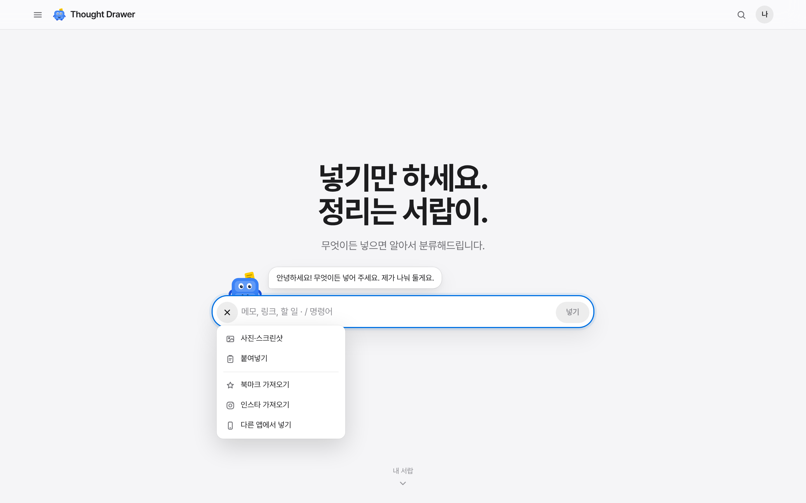
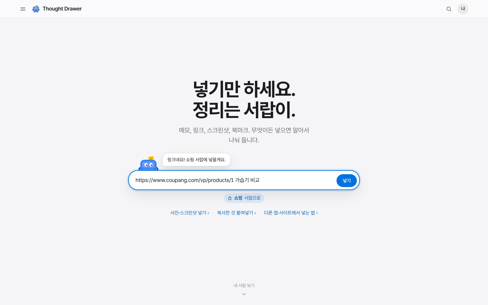
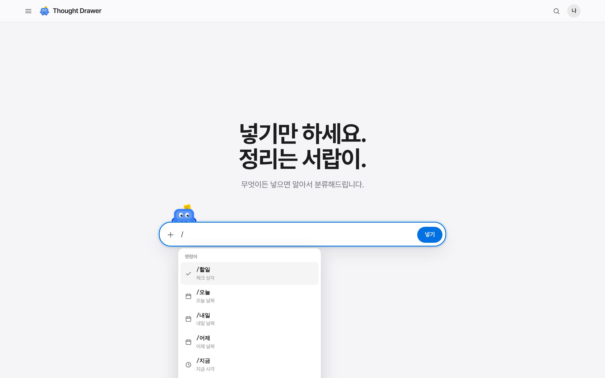
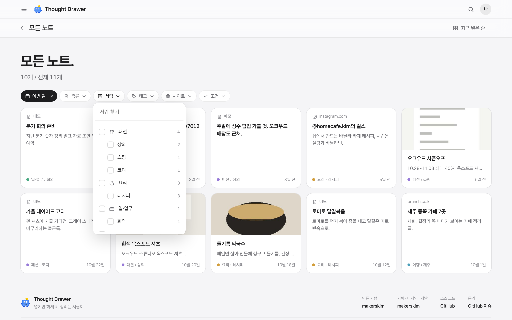
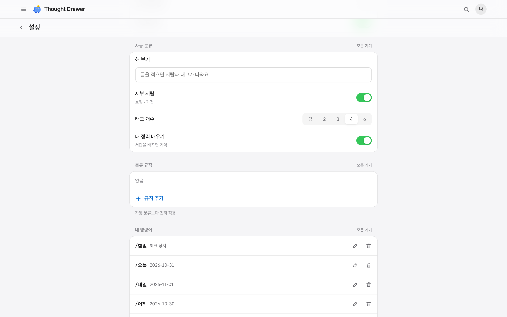
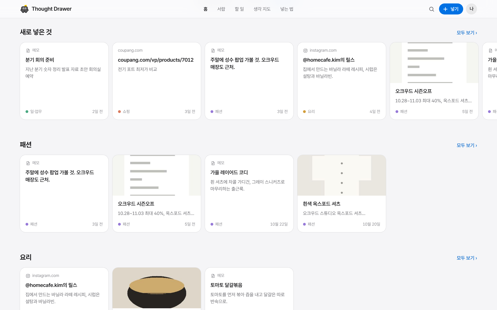
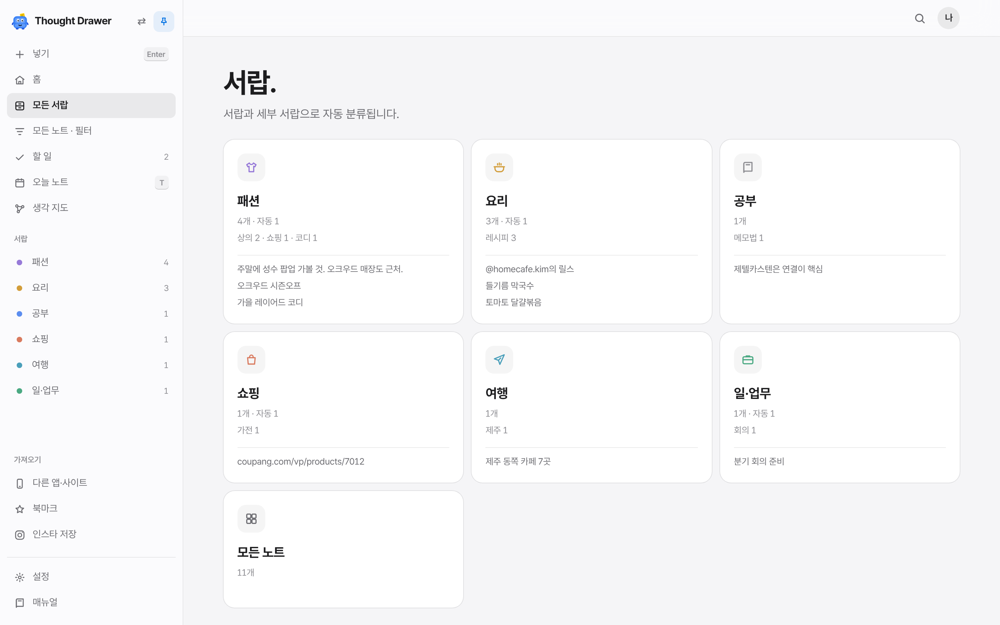
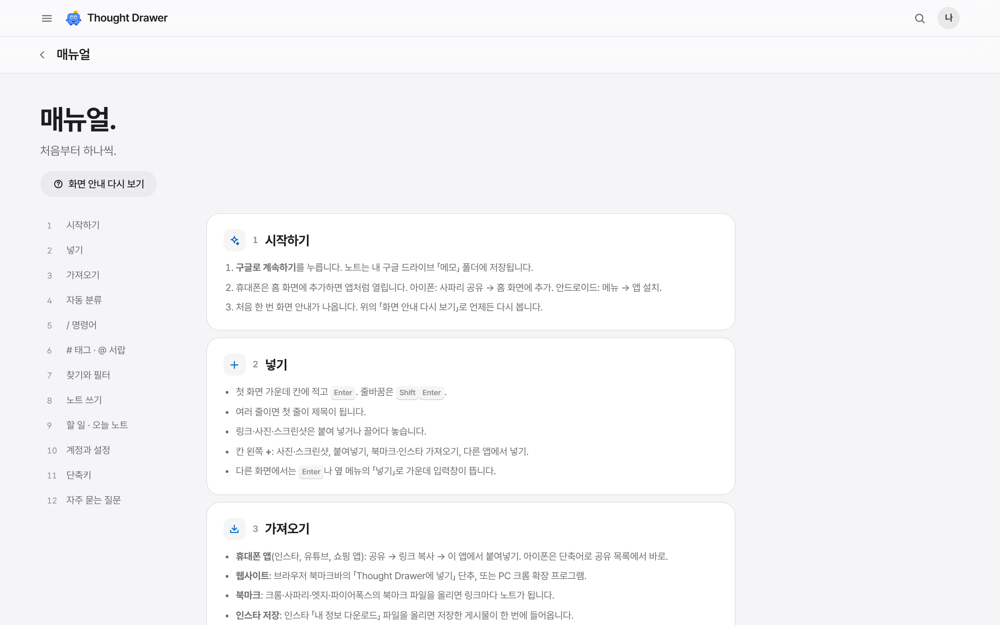
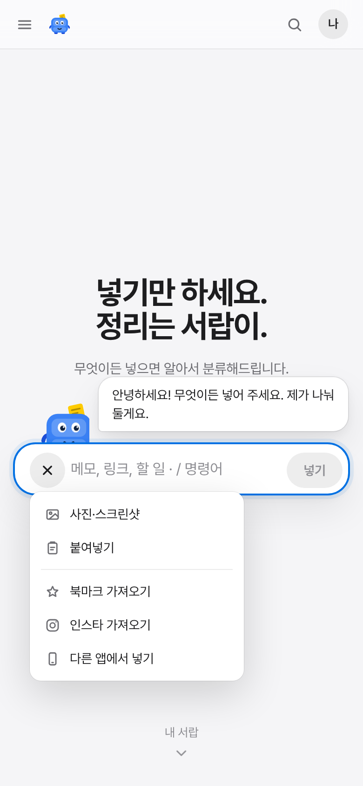

# Thought Drawer

글, 웹사이트, 휴대폰 앱의 링크, 스크린샷, 사진, 인터넷 북마크를 한곳에 넣으면 **알아서 서랍에 나눠 주는** 노트 앱.
노트는 내 구글 드라이브의 `메모` 폴더에 마크다운으로 저장돼서 폰과 PC 어디서든 열리고, 옵시디언에서도 그대로 보인다.

네 가지를 기준으로 만들었다.

1. **쉽게 넣기**: 첫 화면 가운데 긴 칸에 적고 Enter. 링크·사진은 붙여 넣거나 끌어다 놓기. 칸 왼쪽 **+** 를 누르면 목록: 사진·스크린샷, 붙여넣기(복사해 둔 링크·글·사진), 북마크 가져오기, 인스타 가져오기, 다른 앱에서 넣기. 다른 화면에서는 Enter나 옆 메뉴의 「넣기」로 가운데 입력창.
   - **/ 명령어** (노션·옵시디언처럼): 칸에서 `/` 를 치면 목록이 뜬다. `/할일` 체크 상자, `/오늘` `/내일` `/지금` 날짜·시각, `/태그`, `/서랍`, `/사진`, `/붙여넣기`, `/크게`. 노트 편집기의 `/` 메뉴(제목, 목록, 인용, 코드…)에도 날짜와 내 키워드가 있다.
   - **내 키워드**: 설정 → / 명령어에서 `/회의` → 「회의 {오늘} …」처럼 정해 두면 그 글이 통째로 들어간다. `{오늘}` `{내일}` `{지금}` `{요일}`, `#태그`, `@서랍`도 쓸 수 있다.
   - **# 태그 · @ 서랍**: `가습기 비교 #가전 @쇼핑` 처럼 적으면 태그를 달고 그 서랍에 바로 넣는다. `#`, `@`만 쳐도 쓰던 태그·서랍 목록이 뜬다.
2. **어느 기기에서나**: 폰·태블릿·PC 화면에 맞춰지고, 홈 화면에 설치하면 앱처럼 열린다. 모두 같은 드라이브에 저장된다.
3. **무엇이든 담기** (넣는 칸 + → 다른 앱에서 넣기)
   - 휴대폰 앱(인스타, 유튜브, 쇼핑 앱 등): 공유 → 링크 복사 → 앱에서 「붙여넣기」. 안드로이드는 공유 목록에서 바로, 아이폰은 단축어로도.
   - 웹사이트: 모든 브라우저의 북마크바 「Thought Drawer에 넣기」 단추(북마클릿), PC 크롬 확장 프로그램(페이지, 고른 글, 화면 캡처, 이미지).
   - 스크린샷·사진: 여러 장 고르기, 붙여넣기, 끌어다 놓기. 사진 속 글자는 드라이브가 읽어 둬서 글자로 찾을 수 있다.
   - 인터넷 북마크: 크롬·사파리·엣지·파이어폭스의 북마크 파일을 올리면 링크마다 노트가 되고 서랍에 나뉜다. 인스타 저장도 한 번에.
4. **자동 분류**: 넣는 즉시 앱이 **서랍 › 세부 서랍**과 **태그**를 정한다(기본 서랍 10개, 세부 서랍 45개. 예: 쇼핑 › 가전, 여행 › 숙소, 요리·맛집 › 레시피). 순서는 ① 내 분류 규칙 ② 사이트(쿠팡 → 쇼핑, 아고다 → 여행 › 숙소) ③ 낱말 ④ 직접 옮긴 노트에서 배운 것. 태그는 사이트 이름(#쿠팡)과 글 속 낱말(#청소기), 이미 쓰는 태그 중 글에 나온 것을 단다. 이미 쓰던 폴더 이름(「패션/상의」)이 있으면 그 이름을 쓴다. 왜 그 서랍인지도 노트에 적어 준다. 기기 안에서 돌아서 비용이 없다.
   - **분류 규칙**: 설정에서 「다이슨, 발뮤다 → 쇼핑/가전, #브랜드」처럼 정하면 자동 분류보다 먼저 적용된다. 「시험해 보기」 칸에 적으면 어디로 갈지 바로 보여 준다.
   - Claude Code 예약 작업(선택)을 켜면 제목, 한 줄 요약, 태그, 노트 사이 연결까지 붙인다. 내 분류 규칙도 그대로 따른다.

화면은 하나의 디자인 시스템(중립 회색 + 애플 파랑 하나, Pretendard, 정해 둔 간격·모서리·그림자)으로 만든다. 규칙은 [docs/디자인시스템.md](docs/디자인시스템.md).

- **첫 화면은 넣는 칸 하나**: 화면 가운데 「넣기만 하세요. 정리는 서랍이.」, 한 줄 「무엇이든 넣으면 알아서 분류해드립니다.」, 넣는 칸만. 화면 글은 짧게 쓴다. 아래로 내리면 「내 서랍」(이어서 보기, 새로 넣은 것, 서랍마다 옆으로 넘기는 카드 줄)이 차례로 떠오른다.
- **내 계정**: 오른쪽 위 사진을 누르면 구글 계정에 관한 것만 나온다. 이름·이메일, 연결 상태, 저장 공간 막대(메모 · 드라이브 · Gmail·포토 · 남음, 90% 넘으면 경고), 메모 폴더 열기, 동기화, 구글 계정, 로그아웃.
- **옆 메뉴**: 왼쪽 위 ☰로 열고, 핀을 누르면 왼쪽이나 오른쪽에 고정된다. 넣기, 홈, 모든 서랍, 모든 노트·필터, 할 일, 오늘 노트, 생각 지도, 서랍 목록, 넣는 곳, 설정, 사용법. 찾기는 위 막대의 돋보기(`/`, `⌘K`).
- **서랍이와 이야기하기**: 파란 서랍장 마스코트가 넣는 칸 위에 앉아 인사하고, 적는 글을 보고 「쇼핑 서랍이 어울려요」처럼 말해 주고, 넣으면 기뻐하며 뛴다. 사진을 끌어 오면 「여기 놓으세요!」, 가만히 있으면 쓰는 법을 하나씩, 누르면 말을 건다. 알림, 노트의 자동 분류 이유, 빈 화면, 사용법 안내에도 나온다.
- **필터**: 모든 노트·서랍·태그·찾기 화면 위의 막대. 날짜(오늘, 어제, 이번 주, 최근 7일, 이번 달, 최근 30일, 올해, 기간 지정 · 넣은 날/고친 날), 종류, 서랍 › 세부 서랍, 태그(여러 개), 사이트, 조건(할 일 있음, 남은 할 일, 사진 있음, 요약 있음, 즐겨찾기, 직접 정한 서랍, 자동 분류만, 태그 없음), 정렬. 고른 필터는 주소에 남는다.
- **설정**: 화면(밝기, 글꼴, 카드 보기, 정렬, 옆 메뉴, 서랍이 말풍선), 넣기(넣고 바로 열기, 첫 줄 제목), 자동 분류(세부 서랍, 배우기, 자동 태그 수), 분류 규칙, / 명령어, Claude, 공유·내보내기, 단축키. 자동 분류·규칙·키워드는 드라이브 `메모/_시스템/settings.json`에 저장돼 폰과 PC에 함께 적용된다.
- **사용법 화면**: 옆 메뉴 → 사용법. 넣기, / 명령어(내 키워드 포함), # 태그·@ 서랍, 자동 분류, 필터, 편집기, 단축키를 한 장에.
- **옵시디언식 노트 작업 공간**: 같은 서랍 목록 · 속성과 편집기 · 연결/목차/로컬 그래프. `/`나 `Ctrl/⌘ K`의 빠른 실행.
- 밝기는 기기 설정을 따르고, 설정에서 낮·밤으로 고정할 수 있다.

그 밖에: 오늘 노트(`T`), 모든 노트의 체크 상자를 모은 할 일, 빈 새 노트의 템플릿, Claude에게 묻기, 처음 열면 한 곳씩 밝혀 주는 사용법.

| 첫 화면 | + 를 누르면 넣는 방법 목록 | 적는 동안 서랍이가 말해 줌 |
|---|---|---|
|  |  |  |

| / 명령어 | 필터 (날짜 · 서랍 › 세부 서랍) | 설정 (자동 분류 · 규칙 · 키워드) |
|---|---|---|
|  |  |  |

| 아래로 내리면 내 서랍 | 옆 메뉴 고정 | 노트 작업 공간 |
|---|---|---|
|  |  |  |

| 사용법 | 모바일 | 모바일 + 목록 |
|---|---|---|
|  |  |  |

## 시작하기

1. 설정: [docs/설정가이드.md](docs/설정가이드.md)
2. 아이폰 공유 단축어: [docs/단축어.md](docs/단축어.md)
3. 크롬 확장 프로그램: [docs/크롬확장.md](docs/크롬확장.md)
4. 설계와 제텔카스텐 반영 방식: [docs/설계.md](docs/설계.md)

단축키: `Enter` 넣는 칸으로(첫 화면) 또는 가운데 입력창(안에서 `Enter` 넣기, `Shift Enter` 줄바꿈, `Ctrl/⌘ Enter` 넣고 열기, `/` 명령어), `/` 또는 `Ctrl/⌘ K` 찾기와 빠른 실행(입력칸 밖에서), `T` 오늘 노트, `N` 새 노트, `J`/`K` 다음·이전 노트, `Esc` 닫기, `Ctrl/⌘ S` 바로 저장. 크롬 확장은 `Ctrl/⌘ Shift Y`.

## 개발

빌드 도구 없는 정적 사이트다.

```bash
npm run serve                          # http://localhost:8080
npm test                               # 노트 형식, 검색, 자동 분류(세부 서랍·태그·규칙), 필터, / 명령어, 설정, 북마크·인스타 파일 읽기, 할 일, 묻기, 내보내기, 확장 동기화
npm run e2e                            # 화면 시험 (serve 를 켠 채, 브라우저 Playwright 필요)
npm run screens                        # README 스크린샷 다시 만들기
node tools/sync-extension.mjs          # 웹앱 공용 코드를 extension/app 에 복사하고 zip 만들기
python3 -m pytest -q organizer/tests   # 자동 정리기
```

```
index.html, css/app.css      화면 뼈대와 디자인 (라이트/다크)
js/main.js                   시작점
js/core/                     노트 형식, 검색, 자동 분류(classify), 필터(filter), / 명령어(slash), 함께 쓰는 설정(settings), 인스타 파일 읽기, 묻기, 내보내기 (DOM 없음, 테스트 대상)
js/store/                    구글 로그인, 드라이브 저장소, 라이브러리(기기 사본 먼저 보여 주기), 시험용 저장소
js/ui/                       Preact + htm 화면: App, views(서랍, 노트 옆 창, 묻기, 그래프, 설정…), parts(메뉴, 대화상자)
extension/                   크롬 확장 프로그램 (MV3). app/ 은 웹앱 코드 복사본
downloads/                   확장 프로그램 받기용 zip
organizer/                   Claude Code 예약 작업용 정리기 (파이썬 표준 라이브러리)
```

자동 테스트에서는 `window.__TD_TEST__ = { files: [...] }`를 미리 넣으면 드라이브 대신 메모리 저장소로 열린다 (앱 화면에는 나오지 않음).

포함한 외부 라이브러리 (`js/vendor/`): Preact (MIT), htm (Apache-2.0), marked (MIT), DOMPurify (Apache-2.0/MPL-2.0), JSZip (MIT), TipTap (MIT), tiptap-markdown (MIT), qrcode-generator (MIT).
글꼴: Wanted Sans (OFL), 나눔스퀘어라운드 (OFL), JetBrains Mono, Noto Serif KR (OFL).
