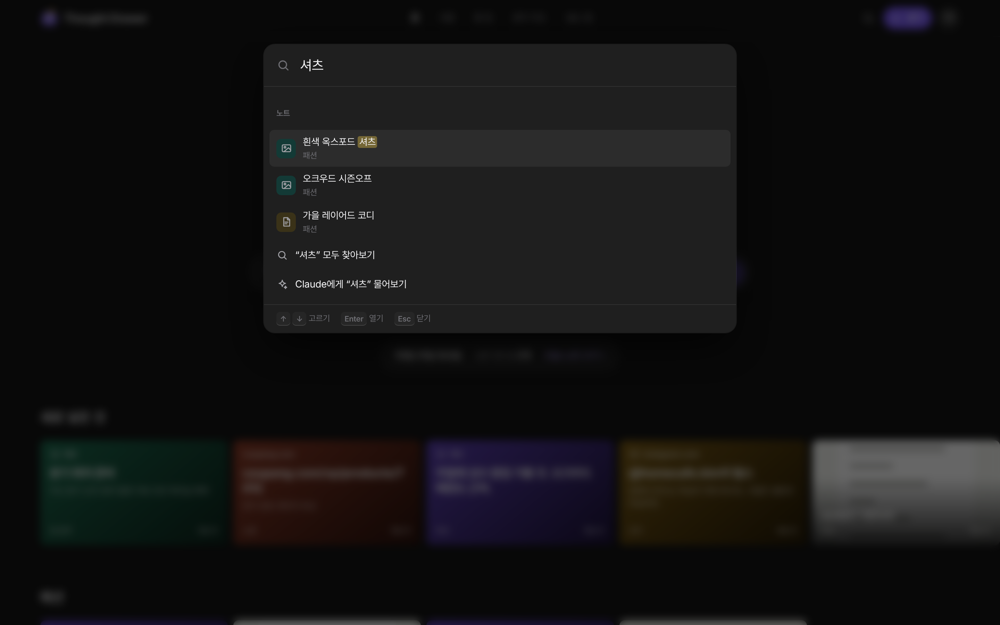

# Thought Drawer

글, 웹사이트, 휴대폰 앱의 링크, 스크린샷, 사진, 인터넷 북마크를 한곳에 넣으면 **알아서 서랍에 나눠 주는** 노트 앱.
노트는 내 구글 드라이브의 `메모` 폴더에 마크다운으로 저장돼서 폰과 PC 어디서든 열리고, 옵시디언에서도 그대로 보인다.

네 가지를 기준으로 만들었다.

1. **쉽게 넣기**: 첫 화면 가운데 긴 칸에 적고 Enter. 링크·사진은 붙여 넣거나 끌어다 놓기. 칸 아래 「사진·스크린샷 넣기 ›」, 「복사한 것 붙여넣기 ›」(복사해 둔 링크·글·사진). 다른 화면에서는 Enter나 위 막대의 「넣기」로 가운데 입력창.
2. **어느 기기에서나**: 폰·태블릿·PC 화면에 맞춰지고, 홈 화면에 설치하면 앱처럼 열린다. 모두 같은 드라이브에 저장된다.
3. **무엇이든 담기** (메뉴 → 다른 앱·사이트에서 넣는 법)
   - 휴대폰 앱(인스타, 유튜브, 쇼핑 앱 등): 공유 → 링크 복사 → 앱에서 「붙여넣기」. 안드로이드는 공유 목록에서 바로, 아이폰은 단축어로도.
   - 웹사이트: 모든 브라우저의 북마크바 「Thought Drawer에 넣기」 단추(북마클릿), PC 크롬 확장 프로그램(페이지, 고른 글, 화면 캡처, 이미지).
   - 스크린샷·사진: 여러 장 고르기, 붙여넣기, 끌어다 놓기. 사진 속 글자는 드라이브가 읽어 둬서 글자로 찾을 수 있다.
   - 인터넷 북마크: 크롬·사파리·엣지·파이어폭스의 북마크 파일을 올리면 링크마다 노트가 되고 서랍에 나뉜다. 인스타 저장도 한 번에.
4. **자동 분류**: 넣는 즉시 앱이 사이트(쿠팡 → 쇼핑, 유튜브 → 영상)와 낱말을 보고 쇼핑, 요리, 여행, 공부, 일, 영상, 건강, 돈, 집, 패션 같은 서랍을 고른다. 이미 쓰던 폴더 이름이 있으면 그 이름을 쓰고, 노트에서 서랍을 바꾸면 그걸 배워서 다음부터 더 잘 나눈다. 왜 그 서랍인지도 노트에 적어 준다. 기기 안에서 돌아서 비용도 설정도 없다. Claude Code 예약 작업(선택)을 켜면 제목, 한 줄 요약, 태그, 노트 사이 연결까지 붙인다.

화면은 세 곳을 참고해 처음부터 다시 짰다.

- **애플 홈페이지의 말과 짜임**: 얇은 위 막대(홈 · 서랍 · 할 일 · 생각 지도 · 넣는 법), 가운데 큰 제목 「넣기만 하세요. 정리는 서랍이.」와 긴 넣는 칸, 「자세히 보기 ›」식 링크, 2단 소개 타일, 작은 글씨 바닥. 낮 화면은 애플식 밝은 회색.
- **넷플릭스**: 검은 바탕에 서랍마다 옆으로 넘기는 포스터 줄(이어서 보기, 새로 넣은 것, 쇼핑, 요리…). 사진 노트는 사진 포스터, 나머지는 서랍 색 포스터에 큰 제목. 마우스를 올리면 커진다.
- **옵시디언**: 노트는 세 칸 작업 공간. 왼쪽은 같은 서랍의 노트 목록, 가운데는 속성(서랍·태그·종류·출처·만든 날)과 편집기, 오른쪽은 연결 · 목차 · 로컬 그래프. `/`나 `Ctrl/⌘ K`의 빠른 실행으로 노트를 찾거나 「오늘 노트」 「설정」 같은 일을 바로 한다. 보라색.

그 밖에: 오늘 노트(`T`), 모든 노트의 체크 상자를 모은 할 일, 빈 새 노트의 템플릿, Claude에게 묻기, 처음 열면 한 곳씩 밝혀 주는 사용법.

| 첫 화면 | 서랍마다 포스터 줄 | 노트 작업 공간 |
|---|---|---|
|  |  |  |

| 빠른 실행 | 모바일 | 처음 열면 나오는 사용법 |
|---|---|---|
|  |  |  |

## 시작하기

1. 설정: [docs/설정가이드.md](docs/설정가이드.md)
2. 아이폰 공유 단축어: [docs/단축어.md](docs/단축어.md)
3. 크롬 확장 프로그램: [docs/크롬확장.md](docs/크롬확장.md)
4. 설계와 제텔카스텐 반영 방식: [docs/설계.md](docs/설계.md)

단축키: `Enter` 넣는 칸으로(첫 화면) 또는 가운데 입력창(안에서 `Enter` 넣기, `Shift Enter` 줄바꿈, `Ctrl/⌘ Enter` 넣고 열기), `/` 또는 `Ctrl/⌘ K` 찾기와 빠른 실행, `T` 오늘 노트, `N` 새 노트, `J`/`K` 다음·이전 노트, `Esc` 닫기, `Ctrl/⌘ S` 바로 저장. 크롬 확장은 `Ctrl/⌘ Shift Y`.

## 개발

빌드 도구 없는 정적 사이트다.

```bash
npm run serve                          # http://localhost:8080
npm test                               # 노트 형식, 검색, 자동 분류, 북마크·인스타 파일 읽기, 할 일, 묻기, 내보내기, 확장 동기화
npm run e2e                            # 화면 시험 (serve 를 켠 채, 브라우저 Playwright 필요)
npm run screens                        # README 스크린샷 다시 만들기
node tools/sync-extension.mjs          # 웹앱 공용 코드를 extension/app 에 복사하고 zip 만들기
python3 -m pytest -q organizer/tests   # 자동 정리기
```

```
index.html, css/app.css      화면 뼈대와 디자인 (라이트/다크)
js/main.js                   시작점
js/core/                     노트 형식, 검색, 인스타 파일 읽기, 묻기, 내보내기 (DOM 없음, 테스트 대상)
js/store/                    구글 로그인, 드라이브 저장소, 라이브러리(기기 사본 먼저 보여 주기), 시험용 저장소
js/ui/                       Preact + htm 화면: App, views(서랍, 노트 옆 창, 묻기, 그래프, 설정…), parts(메뉴, 대화상자)
extension/                   크롬 확장 프로그램 (MV3). app/ 은 웹앱 코드 복사본
downloads/                   확장 프로그램 받기용 zip
organizer/                   Claude Code 예약 작업용 정리기 (파이썬 표준 라이브러리)
```

자동 테스트에서는 `window.__TD_TEST__ = { files: [...] }`를 미리 넣으면 드라이브 대신 메모리 저장소로 열린다 (앱 화면에는 나오지 않음).

포함한 외부 라이브러리 (`js/vendor/`): Preact (MIT), htm (Apache-2.0), marked (MIT), DOMPurify (Apache-2.0/MPL-2.0), JSZip (MIT), TipTap (MIT), tiptap-markdown (MIT), qrcode-generator (MIT).
글꼴: Wanted Sans (OFL), 나눔스퀘어라운드 (OFL), JetBrains Mono, Noto Serif KR (OFL).
