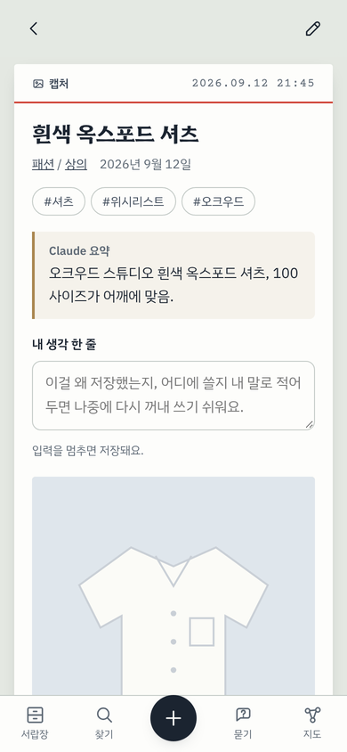
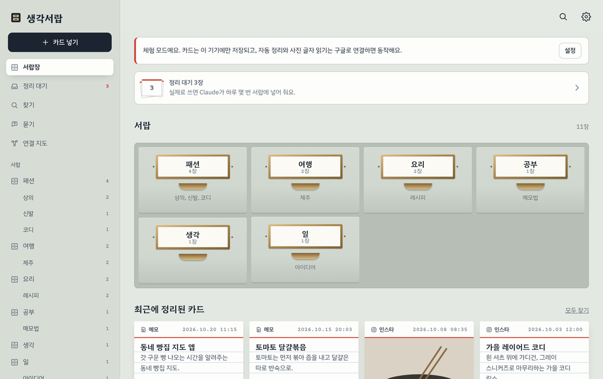

# 생각서랍

메모, 캡처, 웹사이트 북마크, 인스타 저장을 던져 넣으면 Claude가 서랍별로 정리해 주는 웹앱.
카드는 내 구글 드라이브의 `메모` 폴더에 마크다운으로 저장돼서 폰·PC 어디서든 보고, 옵시디언에서 그대로 열린다.

- **넣기**: 메모, 사진·캡처(드라이브 무료 OCR로 글자 추출), 링크, 인스타 저장함 일괄 가져오기, 아이폰 공유 「메모로 보내기」
- **정리**: Claude Code 예약 작업이 하루 몇 번 새 카드만 읽고 제목·서랍·태그·요약·연결을 붙인다 (지금 쓰는 Claude 구독, API 비용 0원)
- **찾기**: 기기 안 검색 (`#태그`, `서랍:패션`, `종류:인스타`), 문장으로 묻기, 연결 지도
- **옮기기**: 옵시디언은 폴더 그대로, 노션은 zip 내보내기

| 서랍장 | 카드 | PC |
|---|---|---|
|  |  |  |

## 시작하기

1. 체험: 앱을 열고 **먼저 체험해 보기** (설정 없이 이 기기에만 저장)
2. 실제 사용: [docs/설정가이드.md](docs/설정가이드.md)
3. 아이폰 공유 단축어: [docs/단축어.md](docs/단축어.md)
4. 설계와 제텔카스텐 반영 방식: [docs/설계.md](docs/설계.md)

## 개발

빌드 도구 없는 정적 사이트다.

```bash
npm run serve                          # http://localhost:8080
npm test                               # 웹앱 핵심 모듈
python3 -m pytest -q organizer/tests   # 자동 정리기
```

```
index.html, css/app.css      화면
js/core/                     카드 형식, 검색, 인스타 파일 읽기, 묻기, 내보내기 (DOM 없음, 테스트 대상)
js/store/                    구글 로그인, 드라이브 저장소, 체험 저장소, 서랍장(라이브러리)
js/ui/                       화면 조각과 화면들
organizer/                   Claude Code 예약 작업용 정리기 (파이썬 표준 라이브러리)
```

포함한 외부 라이브러리: marked (MIT), DOMPurify (Apache-2.0/MPL-2.0), JSZip (MIT) — `js/vendor/`.
