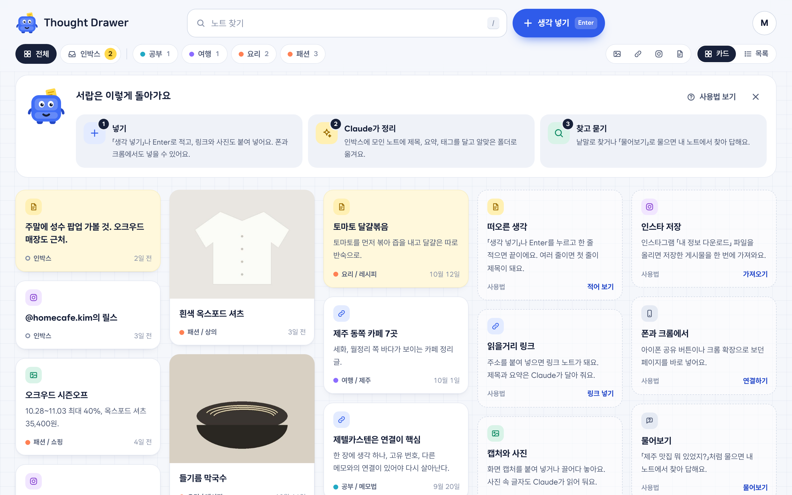
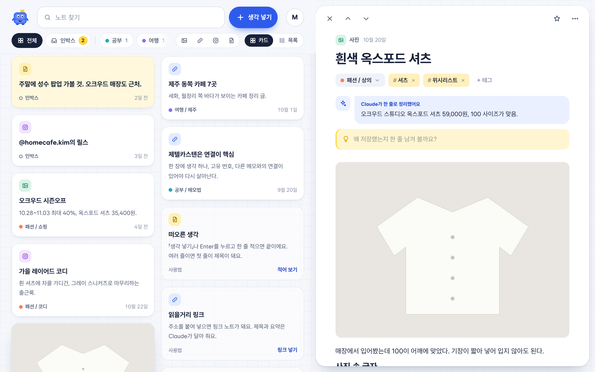
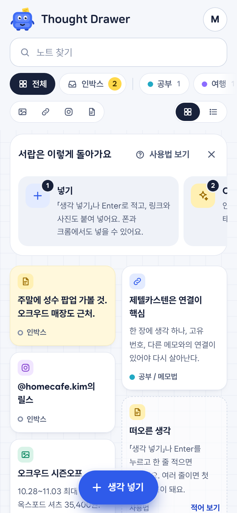

# Thought Drawer

메모, 캡처, 링크, 인스타 저장을 한곳에 던져 넣으면 Claude가 폴더별로 정리하고 서로 이어 주는 노트 앱.
노트는 내 구글 드라이브의 `메모` 폴더에 마크다운으로 저장돼서 폰과 PC 어디서든 열리고, 옵시디언에서도 그대로 보인다.
모눈 종이 위에 흰 카드, 볼펜 파랑과 포스트잇 노랑의 밝은 화면에 서랍장 마스코트 「서랍이」가 사용법을 알려 준다. 색은 파랑, 민트, 귤, 포도 중에서 고른다.

- **넣기**: 어디서든 Enter(폰은 아래 「생각 넣기」)를 누르면 가운데에 입력창이 뜨고, 적고 Enter면 인박스로. 사진 붙여넣기와 끌어다 놓기(드라이브 무료 OCR로 글자 추출), 링크, 인스타 저장함 일괄 가져오기, 아이폰 공유 「메모로 보내기」, 안드로이드 공유, 크롬 확장 프로그램(페이지, 고른 글, 화면 캡처)
- **정리**: Claude Code 예약 작업이 하루 몇 번 인박스의 새 노트만 읽고 제목, 폴더, 태그, 요약, 연결을 붙인다 (지금 쓰는 Claude 구독, API 비용 0원)
- **쓰기**: 큰 제목 아래 폴더·태그·출처 한 줄, 보이는 그대로 편집하는 본문(`/` 블록 메뉴, `[[` 노트 잇기, 사진 붙여넣기), 자동 저장, 즐겨찾기
- **찾기**: 위쪽 찾기 칸에 입력하는 대로 노트 벽이 걸러짐 (`#태그`, `폴더:패션`, `종류:인스타`), 폴더·종류 칩, 문장으로 묻기, 연결과 그래프. 노트는 옆 창에서 열려 `J`/`K`로 넘겨 봄
- **옮기기**: 옵시디언은 드라이브 폴더 그대로, 노션은 zip 내보내기
- **안내**: 처음 열면 화면을 어둡게 덮고 한 곳씩 밝혀 주는 사용법(넘기기, 이전, 확인). 메뉴의 「사용법 다시 보기」로 다시 본다. 노트가 적을 때는 「서랍은 이렇게 돌아가요」와 쓰는 법 카드가 빈자리를 채운다

| 홈 | 노트 | 모바일 |
|---|---|---|
|  |  |  |

| Enter로 여는 가운데 입력창 | 처음 열면 나오는 사용법 |
|---|---|
|  |  |

## 시작하기

1. 설정: [docs/설정가이드.md](docs/설정가이드.md)
2. 아이폰 공유 단축어: [docs/단축어.md](docs/단축어.md)
3. 크롬 확장 프로그램: [docs/크롬확장.md](docs/크롬확장.md)
4. 설계와 제텔카스텐 반영 방식: [docs/설계.md](docs/설계.md)

단축키: `Enter` 가운데 입력창(안에서 `Enter` 넣기, `Shift Enter` 줄바꿈, `Ctrl/⌘ Enter` 넣고 열기), `/` 또는 `Ctrl/⌘ K` 찾기 칸으로, `N` 새 노트, `J`/`K` 다음·이전 노트, `Esc` 닫기, `Ctrl/⌘ S` 바로 저장. 크롬 확장은 `Ctrl/⌘ Shift Y`.

## 개발

빌드 도구 없는 정적 사이트다.

```bash
npm run serve                          # http://localhost:8080
npm test                               # 노트 형식, 검색, 인스타 파일 읽기, 묻기, 내보내기, 확장 프로그램 동기화
node tools/sync-extension.mjs          # 웹앱 공용 코드를 extension/app 에 복사하고 zip 만들기
python3 -m pytest -q organizer/tests   # 자동 정리기
```

```
index.html, css/app.css      화면 뼈대와 디자인 (라이트/다크)
js/main.js                   시작점
js/core/                     노트 형식, 검색, 인스타 파일 읽기, 묻기, 내보내기 (DOM 없음, 테스트 대상)
js/store/                    구글 로그인, 드라이브 저장소, 라이브러리(기기 사본 먼저 보여 주기), 시험용 저장소
js/ui/                       Preact + htm 화면: App, views(서랍, 노트 옆 창, 묻기, 그래프, 설정…), parts(메뉴, 대화상자)
extension/                   크롬 확장 프로그램 (MV3). app/ 은 웹앱 코드 복사본
downloads/                   확장 프로그램 받기용 zip
organizer/                   Claude Code 예약 작업용 정리기 (파이썬 표준 라이브러리)
```

자동 테스트에서는 `window.__TD_TEST__ = { files: [...] }`를 미리 넣으면 드라이브 대신 메모리 저장소로 열린다 (앱 화면에는 나오지 않음).

포함한 외부 라이브러리 (`js/vendor/`): Preact (MIT), htm (Apache-2.0), marked (MIT), DOMPurify (Apache-2.0/MPL-2.0), JSZip (MIT), TipTap (MIT), tiptap-markdown (MIT), qrcode-generator (MIT).
글꼴: Wanted Sans (OFL), 나눔스퀘어라운드 (OFL), JetBrains Mono, Noto Serif KR (OFL).
